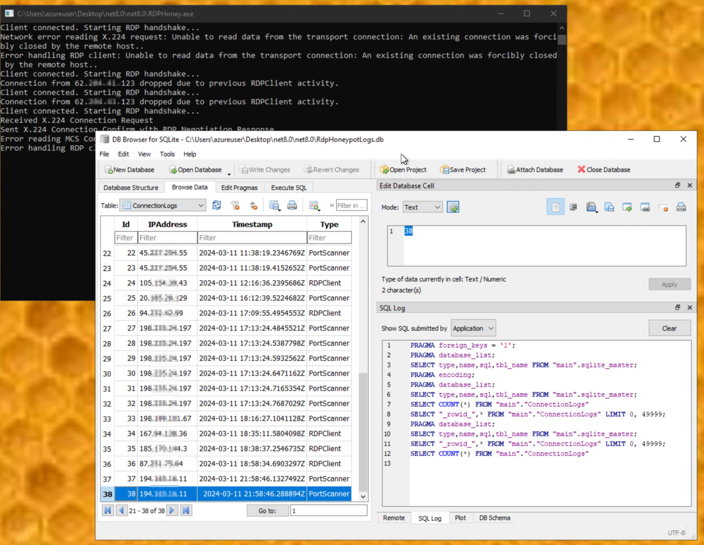

# RDPHoneyPot

[](https://dotnet.microsoft.com/)
[](docker-compose.yml)
[](LICENSE)

An RDP honeypot in C#. It speaks enough of MS-RDPBCGR to hold a real conversation with a client, which means it can tell a person using `mstsc.exe` from a scanner or a brute-force tool, and it collects credentials from both.



## What it does

It negotiates RDP with a dynamically generated self-signed certificate. Interactive clients get a Windows logon screen, Fast-Path keystroke capture, and a static desktop image streamed back after they type anything; every credential is accepted. Tools like Hydra, Crowbar and Ncrack send usernames and passwords in the protocol-level Client Info PDU, which the honeypot reads directly.

Captured usernames, passwords, source IPs, UTC timestamps, and AbuseIPDB report statuses go into SQLite at `./data/RdpHoneypotLogs.db`. Sessions are held for a random 3 to 6 seconds and then dropped. If `AUTO_BAN_RDP_CLIENTS` is on, repeat clients are refused before the TLS handshake, so known scanners don't eat handshake resources. When `ABUSEIPDB_API_KEY` is configured, banned `RDPClient` IPs are automatically reported to AbuseIPDB (`/api/v2/report`), while private, loopback, and the host's own public IP are automatically excluded.

Everything is .NET 10 with no native dependencies, and a single `docker compose up` brings up the honeypot plus a read-only `sqlite-web` console bound strictly to `127.0.0.1:8080`. The database runs in WAL mode, so you can query it from the host while the honeypot keeps writing.

`EnrichReportWithIPDB.ps1` adds AbuseIPDB confidence scores, ISP, geolocation and Tor exit status to exported CSV logs.

## Run it

Docker Compose is the intended path:

```bash
git clone https://github.com/dmitryporotnikov/RDPHoneyPot.git
cd RDPHoneyPot
cp .env.example .env
docker compose up -d --build
docker compose ps
```

The honeypot listens on `3389`, and the read-only database UI is bound locally to `http://127.0.0.1:8080` (not exposed on public interfaces).

With the .NET 10 SDK instead:

```bash
dotnet restore
dotnet build -c Release
dotnet run --project RDPHoney -c Release
dotnet test
```

## Deploying on a VPS

1. Provision a Linux VPS and allow inbound TCP port `3389` in your cloud firewall / `ufw` (keep port `8080` closed to the internet).
2. Clone the repository and configure `.env`:

   ```bash
   git clone https://github.com/dmitryporotnikov/RDPHoneyPot.git
   cd RDPHoneyPot
   cp .env.example .env
   ```

3. (Optional) Enable automatic AbuseIPDB reporting for banned RDP clients by setting your APIv2 key in `.env`:

   ```ini
   HONEYPOT_PORT=3389
   AUTO_BAN_RDP_CLIENTS=true
   ABUSEIPDB_API_KEY=your_abuseipdb_api_v2_key
   ABUSEIPDB_ENABLED=true
   ABUSEIPDB_CATEGORIES=18,15
   # Optional: comma-separated IPs to never report (your VPS public IP and private IPs are excluded automatically)
   ABUSEIPDB_EXCLUDED_IPS=
   ```

4. Start the containers:

   ```bash
   docker compose up -d --build
   ```

5. Access the SQLite web UI securely from your workstation via SSH port forwarding (since `db-admin` is bound to `127.0.0.1:8080` on the VPS):

   ```bash
   ssh -L 8080:127.0.0.1:8080 user@your-vps-ip
   ```

   Then open `http://localhost:8080` in your local browser. See [documentation/DOCKER_DEPLOYMENT.md](documentation/DOCKER_DEPLOYMENT.md) for the full VPS deployment and hardening guide.

## Configuration

Set these in the environment or in `.env` next to `docker-compose.yml`:

| Variable | Default | What it does |
|---|---|---|
| `HONEYPOT_PORT` | `3389` | TCP port for RDP traffic. |
| `DATABASE_PATH` | `data/RdpHoneypotLogs.db` | SQLite file. |
| `DB_ADMIN_PORT` | `8080` | Localhost port for the read-only `sqlite-web` UI (`127.0.0.1:8080`). |
| `STATIC_JPG_PATH` | `assets/desktop.jpg` | Image shown to authenticated clients. |
| `AUTO_BAN_RDP_CLIENTS` | `true` | Drop IPs already logged as RDP clients. |
| `MAX_CONCURRENT_CONNECTIONS` | `64` | Maximum simultaneous RDP handshakes/sessions. |
| `ABUSEIPDB_API_KEY` | *(empty)* | AbuseIPDB APIv2 key to automatically report banned `RDPClient` IPs. |
| `ABUSEIPDB_ENABLED` | `true` | Enable/disable automatic AbuseIPDB reporting when key is set. |
| `ABUSEIPDB_CATEGORIES` | `18,15` | AbuseIPDB category IDs (`18` = Brute-Force, `15` = Hacking). |
| `ABUSEIPDB_EXCLUDED_IPS` | *(empty)* | Additional IPs to never report (own public IP & private IPs are auto-excluded). |

[documentation/CONFIGURATION.md](documentation/CONFIGURATION.md) has the full set, including aliases.

## Reading the capture

The database is mounted from the host, so DB Browser for SQLite, DBeaver or the CLI all work:

```bash
sqlite3 -header -column data/RdpHoneypotLogs.db \
  "SELECT Id, IPAddress, Username, Password, ReportedToAbuseIPDB, AbuseConfidenceScore FROM ConnectionLogs WHERE Username IS NOT NULL;"
```

## Documentation

- [Architecture](documentation/ARCHITECTURE.md): packet handling, protocol simulation, capture and classification.
- [Docker deployment](documentation/DOCKER_DEPLOYMENT.md): volumes, firewall rules, container management.
- [Database guide](documentation/DATABASE_GUIDE.md): schema, WAL concurrency, queries from the host.
- [Configuration](documentation/CONFIGURATION.md): environment variables and ports.
- [Threat intelligence](documentation/ANALYSIS_AND_ENRICHMENT.md): AbuseIPDB enrichment and SIEM export.

## License

MIT. See [LICENSE](LICENSE).
